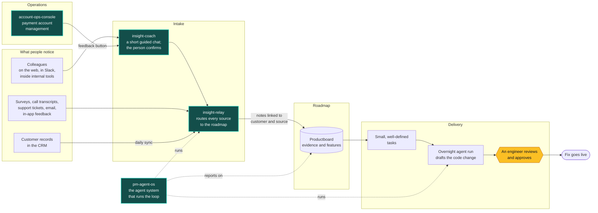

  

  
  
  

Head of Product in hospitality commerce and payments. I build the systems my product teams run on: AI agents do the reading and drafting, and people make the decisions.

My [portfolio](https://github.com/sirk-code87/portfolio) documents systems I designed and shipped at a UK hospitality commerce company and, before that, at a restaurant ordering and payments platform. Each one covers the problem, how the system works, the decisions behind it, how it was built month by month, and what I'd do differently. The original systems and their code belong to those companies.

## Start here

<table>
<tr>
<td width="50%" valign="top">

### [pm-agent-os](https://github.com/sirk-code87/portfolio/tree/main/pm-agent-os)
The AI agent system I ran a product leadership role on: nine specialist lenses, a weekly report built only from logged facts, and a gate that holds every outgoing message for my approval.

1,177 decision records · 4,470 logged work events · nine months in daily use

</td>
<td width="50%" valign="top">

### [account-ops-console](https://github.com/sirk-code87/portfolio/tree/main/account-ops-console)
A tool I built during a payments incident that grew, in about five weeks, into the operations team's console for every merchant payment account.

Stripe Connect · threat-modelled first write · fail-closed audit log

</td>
</tr>
<tr>
<td width="50%" valign="top">

### [insight-coach](https://github.com/sirk-code87/portfolio/tree/main/insight-coach)
A two-to-three question chat that turns "something I noticed" into an evidenced product insight, credited to the customer and the colleague who raised it.

Web, Slack and embedded in internal tools · evaluation harness

</td>
<td width="50%" valign="top">

### [insight-relay](https://github.com/sirk-code87/portfolio/tree/main/insight-relay)
One intake for about ten feedback sources. People confirm what they file; automated sources pass an AI judge and a trial run before anything reaches the roadmap.

96% accuracy on hand-checked call notes · every lane starts in dry-run

</td>
</tr>
</table>

**[Product case studies](https://github.com/sirk-code87/portfolio/tree/main/product-case-studies)**: product decisions told as problem, solution and impact. Start with [Retuning fraud rules that were turning away good guests](https://github.com/sirk-code87/portfolio/tree/main/product-case-studies/fraud-rules-blocking-good-guests): a reversible call made live, measured against triggers agreed in advance. More are being added.

## How the pieces fit

What customers and colleagues notice becomes evidence on the product roadmap. The roadmap becomes small code changes that an engineer reviews. The agent system runs the loop and stops for a person at every step that can't be undone.

Teal: systems documented in the portfolio. Amber: where a person decides.

## How I work

- **Agents draft; a person decides.** Every outgoing message and publication waits for my approval, and every code change starts as a proposal an engineer can review.
- **Facts first.** Facts are recorded as the work happens, so every claim in a report traces back to a record.
- **Decisions on paper.** Every decision is written down with who made it, when, and how easily it can be reversed.
