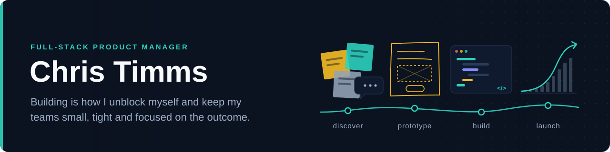

  

  
  
  

I get products from a customer's problem to a measured result faster. I can step into any stage, from discovery to rollout, so the work keeps moving and the specialists around me stay on the problems that need them.

My [portfolio](https://github.com/sirk-code87/portfolio) is where I keep the things I've built and the product decisions behind them, from a UK hospitality commerce company and, before that, a restaurant ordering and payments platform. Each one covers the problem, how it works, the decisions behind it and what I'd do differently. The originals and their code belong to those companies.

## What I've built

<table>
<tr>
<td width="50%" valign="top">

### [account-ops-console](https://github.com/sirk-code87/portfolio/tree/main/account-ops-console)
A tool I built during a payments incident that grew, in about five weeks, into the operations team's console for every merchant payment account.

Stripe Connect · threat-modelled first write · fail-closed audit log

</td>
<td width="50%" valign="top">

### [insight-coach](https://github.com/sirk-code87/portfolio/tree/main/insight-coach)
A two-to-three question chat that turns "something I noticed" into an evidenced product insight, credited to the customer and the colleague who raised it.

Web, Slack and embedded in internal tools · evaluation harness

</td>
</tr>
<tr>
<td width="50%" valign="top">

### [insight-relay](https://github.com/sirk-code87/portfolio/tree/main/insight-relay)
One intake for about ten feedback sources. People confirm what they file; automated sources pass an AI judge and a trial run before anything reaches the roadmap.

96% accuracy on hand-checked call notes · every lane starts in dry-run

</td>
<td width="50%" valign="top">

### [pm-agent-os](https://github.com/sirk-code87/portfolio/tree/main/pm-agent-os)
My own AI workspace for day-to-day product work: agents that read, draft and keep the record, with every outgoing message held for my approval.

1,177 decision records · 4,470 logged work events · nine months in daily use

</td>
</tr>
</table>

## [Product case studies](https://github.com/sirk-code87/portfolio/tree/main/product-case-studies)

Calls I've made as a product manager, each written up as the problem, what I did and what changed. More are on the way.

- **[Retuning fraud rules that were turning away good guests](https://github.com/sirk-code87/portfolio/tree/main/product-case-studies/fraud-rules-blocking-good-guests)**: a fraud rule was declining genuine guests, some of them eight times on one booking. I narrowed it live, wrote down when I'd reverse it before any results came in, and cut its blocks by 95% with no rise in fraud warnings.
- **[An upsell engine operators would trust with their margins](https://github.com/sirk-code87/portfolio/tree/main/product-case-studies/upsell-engine)**: restaurant operators lost a working day or more every menu cycle building upsell lists by hand. I chose a machine learning engine that learned from real orders, and when the pilot showed operators wouldn't trust a black box, the second release gave them an audit trail and their own rules. Average transaction value rose 8% to 12% against control groups.
- **[An integration hub that products would choose to use](https://github.com/sirk-code87/portfolio/tree/main/product-case-studies/integration-hub)**: a software group sold one connected suite, but each acquired product ran its own integrations. I designed a shared hub where products keep their own swap-in connectors, named adoption as the real risk, and proved the architecture on a low-risk reservations use case before anything was sold on it.

## How I work

- **Build to learn.** A working version in front of real users answers more than a spec, so I start with the smallest version that tests the idea.
- **Measure before claiming.** Every outcome I report traces back to a record, and anything still open is labelled as open.
- **Decisions on paper.** Every decision is written down with who made it, when, and how easily it can be reversed.
- **AI drafts; a person decides.** I use AI agents heavily, and every outgoing message or code change waits for a person to approve it.
